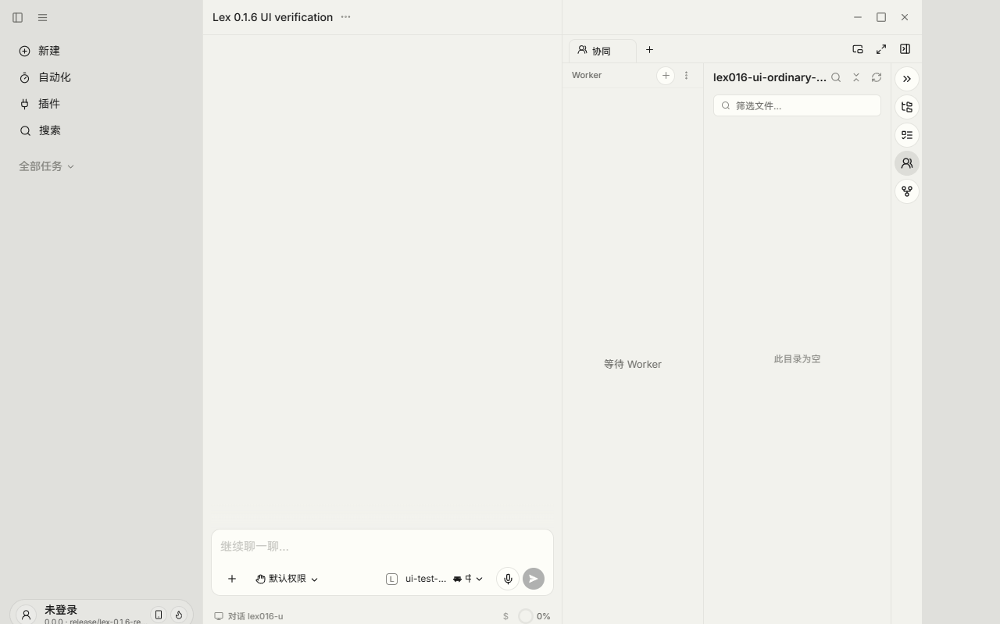
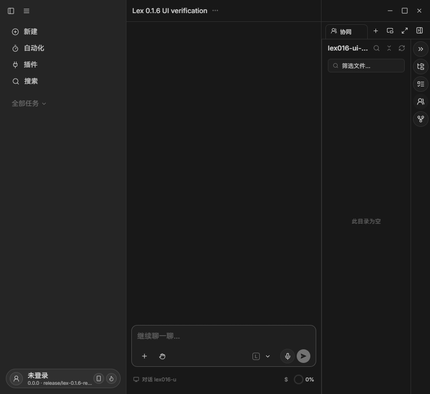

# Lex 0.1.6 本地 UI 验收

2026-10-16，Windows，`release/lex-0.1.6-retire-companions`，基于
`ddb3cabb761ab51c118bf23f1da7966452535a21` 的本次实现。

## 桌面真实产品

通过标准 `pnpm restart:desktop:remote --region=global --isolated=lex016-retirement --passive`
启动，取得 `DESKTOP_DEV_VERDICT=ready`。使用独立 userData、新空 Claude 配置；
Playwright 经本次 CDP 操作真实 Electron 产品 DOM、preload 和 Main IPC，无 iframe 或模拟 IPC。

- 以未登录模式进入，伙伴入口消失，普通任务、自动化、插件及 IM 配置继续存在。
- 真实供应商向导保存隔离配置中的占位 Responses 渠道和模型，没有向供应商发送请求。
- 经真实 preload 准备普通任务并打开产品任务页，模型菜单显示具体供应商和渠道。
  这是 fixture 准备，不表示点击发送或真实模型调用成功。
- 文件面板、空 Orca 面板及普通自动化表单可打开，右侧栏添加菜单没有伙伴专属流程。
- Esc 关闭模型菜单、侧栏菜单和自动化弹窗；旧 `/bots/legacy-test` 重定向到普通新建入口。
- 实际切换 Light / Dark；真实约 886 像素宽窗口目检。以下为原生窗口截图，
  不采用 CDP 透明背景截图的黑色侧栏作为主题证据。
- 通过产品正常退出，开发实例和本次 CDP 监听均已结束，未操作正式安装或用户资料。

## Android 范围与限制

通过标准 `mobile:sim:start` 使用专用 `lex-admin-api36` 模拟器、
`io.github.ciciyl.lex.admin.e2e` 开发包和本 checkout Metro。单独运行手机端后，
真实 Android bundle 完成（4805 modules），实际界面显示 Lex 登录页。
先前与桌面同时运行的 OOM 记录保留，不算成功。

没有可用测试账号，未绕过认证。因此手机首页、旧伙伴深链、Stop 后删除消息的
完整产品操作尚未验收；自动化组件和协议测试不能替代这项验收。
测试后仅停止本轮开发包、模拟器和 Metro。没有重新安装、清除存储或复制用户凭证。

未覆盖真实供应商请求、真实远程设备传输、旧账号 UI、四引擎业务会话和安装升级。
旧伙伴资料保留另由真实数据库与文件 fixture 验证。
