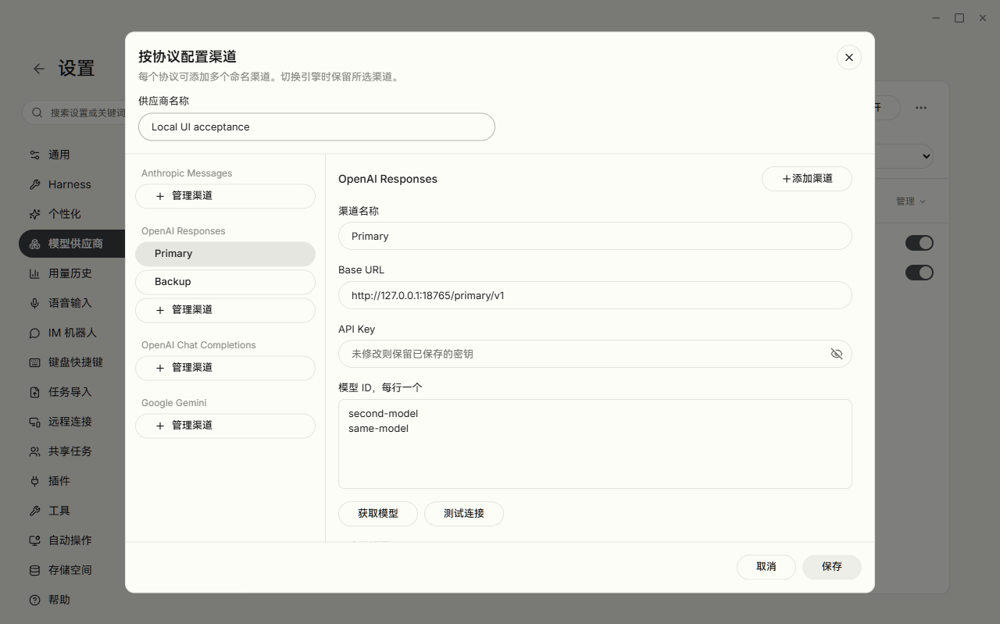
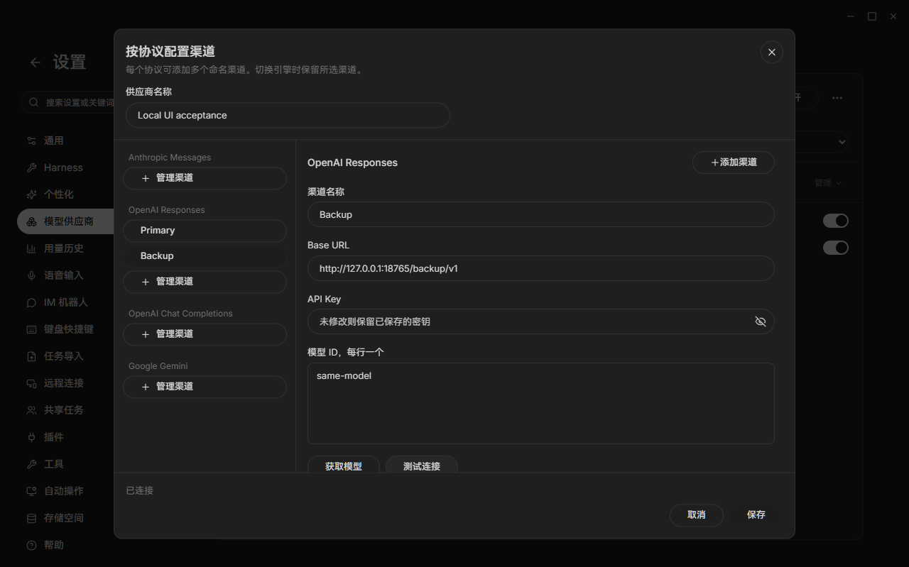
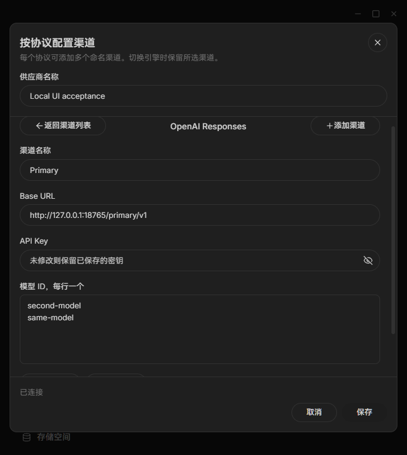
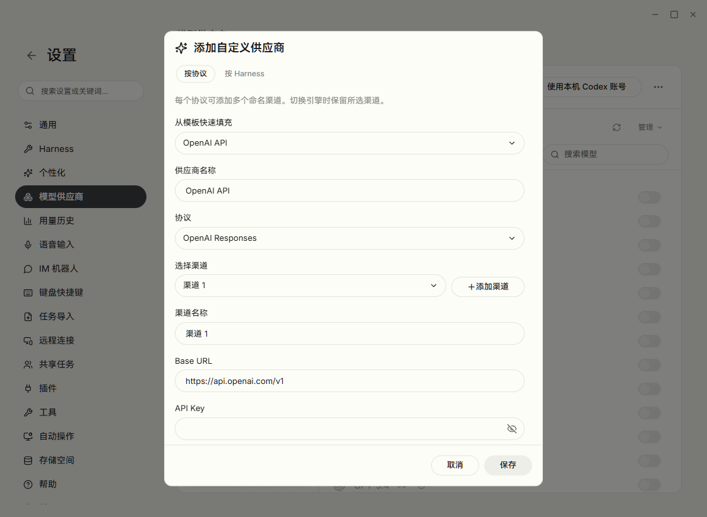
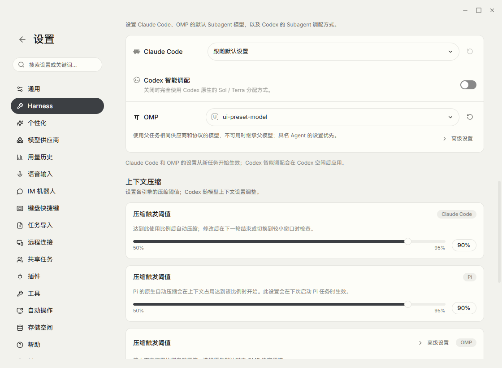
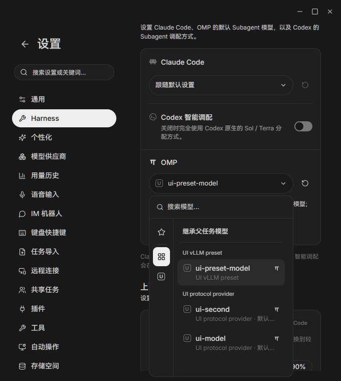

# 协议渠道表单本地验收

2026-10-15，Windows x64；分支 `fix/cindy-v0108-stability-provider-ux`，
基于 `0db3bd88e9a357e9986fab958a25d0f8bf54354f` 的未提交实现。通过
`pnpm restart:desktop:remote --region=global --isolated=cindy-v0108-ux` 启动，
取得 `DESKTOP_DEV_VERDICT=ready`。页面显示对应分支构建标识；使用独立 profile、
跳过登录、假密钥与 `127.0.0.1` 模型服务，没有使用个人供应商账号。

操作使用真实 Electron 界面和 Main IPC，通过开发实例 CDP 点击、输入、键盘与截图；
不是组件替身。伙伴抽屉关闭另以系统窗口坐标点击，再读取窗口树确认关闭。

| 场景 | 实际结果 |
| --- | --- |
| 同协议两个渠道 | Primary/Backup 各自 URL/key/模型草稿保留；同名模型不丢来源 |
| 测试与发现 | 真正向本机服务发送 Responses POST 和 models GET，显示连接成功并添加模型 |
| 保存与重新打开 | 两渠道持久化；密钥输入保持空白，使用 Main 已存密钥仍可连接 |
| 专用配置往返 | 渠道与专用表单两边草稿均保留 |
| 未保存关闭 | Esc 出现确认，继续编辑保留草稿，放弃后关闭 |
| 预设替换 | OpenAI API 预设取消替换保留名称；确认替换填入两协议；再关闭可正常丢弃 |
| 键盘 | 连续 18 次 Tab 焦点保持在对话框内 |
| 失败反馈 | 本机服务返回 401 后显示安全中文错误，不展示原始模拟错误或假密钥 |
| 窄窗 | 680×760 列表/详情/返回可操作，保存按钮在视口内，内容可滚动 |
| 浅色/深色 | 实际通过通用设置切换，两模式均已查看截图 |
| 伙伴抽屉关闭 | 在标题拖动区内真实点击 X 后，抽屉消失，任务窗口保留 |

验收发现保存按钮错误显示 `common.save`，已改为现有正确译文。预设自动化首次在
确认框退出动画中发送 Esc，脚本等待超时；补上确认框隐藏等待后完整操作通过。
两类问题的原始证据保留，不能将初次脚本超时报告为操作通过。

设计依据：`DESIGN.md` §2/§10 的主题语义色、§4 的表单/对话框结构、§5 的点击目标和
圆角分类；采用现有 Button/Input/Select，不新增硬编码色或设计 Token。

边界：已连接的 Android 平板没有可用 Lex/Expo 开发客户端，本机也无可用模拟器；
因此本轮手机验证限于本地单测，未做实机触控、键盘弹起、弱网重连或两端模型切换。
未进行真实供应商计费请求、SSH 会话、四引擎实测对话、Android 覆盖升级或 macOS/Linux
界面验收。伙伴群设置关闭有组件回归，未创建真实群聊点击。桌面开发实例与假服务验收后
正常退出；未关闭正式 Lex 或宿主 Cindy。

## PR82 CI 跟进（2026-10-15）

本轮另修复远程伙伴记忆删除后重复加载列表、与下一条详情请求竞争的问题。可控迟到
列表／详情回归覆盖删除、连续导航、编辑保存，以及旧资源／旧伙伴回包不得覆盖当前
内容。原有忙态、草稿、冲突与 CAS 回归保留。这些是组件测试，不能视为真实界面验收。

本轮隔离 Electron 启动前检查发现本机 OMP 未满足固定 18.10.4 pin；标准启动器会尝试
准备该可选引擎。当时 Lead 给本轮执行设定的边界未允许准备开发引擎资产，因此该阶段
未启动开发实例，也未执行新增记忆场景的实际界面验收；这不是用户禁止本地 UI 测试。
上表此前完成的供应商表单验收不覆盖这个新增场景。该阶段未使用用户正式资料或关闭
正式 Lex／Cindy；后续补验如下，原阻塞与失败记录保留。

### 隔离 Electron 补验

Lead 随后明确允许标准启动器准备仓库固定版本的开发资产。标准入口为：

    pnpm restart:desktop:remote --region=global --isolated=pr82-memory-ui --isolated-auth --passive

取得 DESKTOP_DEV_VERDICT=ready，主进程 PID 30744、CDP 9442；专用沙箱为
LexGlobal-dev2-pr82-memory-ui。Codex 使用标准凭证隔离，Claude 使用本轮新建的空
配置目录，不登录正式账号。现有 Claude、Codex、Pi 与 ripgrep 资产位于本 checkout
apps 目录，真实路径未链接到正式安装。OMP 18.10.4 官方固定制品下载因原有低速预算
中止，启动器按既有可选资产语义继续；没有换下载通道、伪造标记或开启引擎会话。

实际操作在该 Electron 主窗口内的独立同源 iframe 挂载未改写的记忆组件及真实主题、
翻译和 React/router；只模拟 iframe 的 deviceLink.invoke。该 frame 没有特权 preload，
未覆盖主窗口的真实接口。这是实际 Electron 组件交互，不能等同完整路由／Main IPC、
真实远程设备或 device-link 传输验收。

| 补验场景 | 实际结果 |
| --- | --- |
| 删除 Original → 刷新未回 → 打开 Tone → 编辑保存 | 只发一次删除后列表刷新；保存前重新读取，精确使用 b1 CAS，写后回读 b2 |
| 迟到列表成功／失败 | 保存后分别放回旧列表或错误，当前内容保留，没有旧错误提示 |
| 迟到详情成功／失败 | 原详情未回时返回并打开 Tone，保存后放回旧详情或错误，不覆盖当前内容 |
| 键盘 | Enter 打开 Tone，键入正文，Tab 到保存，Enter 提交 |
| 窄窗与主题 | 1080×760 浅色、680×760 浅色／深色均实际操作；查看截图，保存按钮留在视口内 |

首次截图脚本误选预热的辅助窗口而超时；另一次脚本未兼容 Vite 的 CommonJS default
导出，均保留原记录。修正外部脚本后四场景通过，未改产品逻辑来迁就脚本。
实际浅色截图还发现原保存按钮将 HSL 格式的 accent token 当完整颜色使用，导致白字
几乎不可见；仅改用现有 CTA 背景／前景 token，并将未注册的 status-danger 改用现有
伙伴 danger token。随后四场景再验通过，实际按钮文字对比度均高于 4.5:1；未新增主题
token 或改变布局。截图及请求序列／CAS 记录位于仓库外本轮 continuation 证据目录。

验收后通过窗口“关闭”及“退出 Lex”正常退出，最终本 checkout 无开发实例，9442
监听已关闭。未关闭正式 Lex／Cindy，未执行真实供应商请求、付费会话、真实远程设备
或手机触控／弱网／扫码／升级验收。Pi 原始两个 20 秒超时的首次阻塞点仍未被证明；
新增真实文件系统回归只证明 fixture 清理必须等待异步 body 与 mutation-lock tail。

## 紧凑供应商与 OMP 设置补验（2026-10-18）

标准隔离启动器 `pnpm restart:desktop:remote --region=global --isolated=provider-harness-ux --isolated-auth --passive`
返回 `DESKTOP_DEV_VERDICT=ready`，主进程 PID 34296、CDP 9443。Claude 使用本轮空配置目录，
Codex 使用标准隔离授权；四个固定引擎资产均已存在，OMP 为 18.10.4，无本轮资产下载。
使用「跳过登录」进入真实产品路由、preload 和 Main IPC，没有替换产品接口或挂载组件替身。

| 场景 | 实际结果 |
| --- | --- |
| 添加供应商 | 最大 600px 单列表单；顶部「按协议 / 按 Harness」切换，两边草稿保留 |
| 键盘 | 方向键往返后焦点留在所选 Tab；18 次 Tab 均留在弹窗；Esc 先确认未保存更改 |
| 连接和模型发现 | 假密钥只发往本机 127.0.0.1:18768；Main IPC 实际 POST /v1/responses、GET /v1/models 成功 |
| 保存重开 | 两个模型持久化；重开时密钥输入为空，不回显已存密钥 |
| 预设 | 协议表单显示已选 OpenAI API 模板；Harness 表单的 vLLM 模板提供 OMP 协议配置 |
| OMP Subagent | 保存本机 vLLM 模板连接后，模型实际出现在选择器；选择后 Main IPC 回读及设置重开均保留 |
| OMP 记忆 | 行尾常驻图标，确认明确只清 OMP 原生记忆、不含统一记忆；取消未执行清理 |
| OMP 压缩 | OMP 标签在标题末位；收起时无开关/组恢复按钮；高级区有具名开关，修改后恢复默认实际生效 |
| 双主题、窄窗 | 浅色/深色、1120×820 与 680×760 实际操作；截图已查看；表单底部按钮保持可见 |

实机发现并修复了协议 fieldset 的滚动溢出、Tab 选中背景不明显，以及 OMP 模型字段被高级入口/
自定义状态挤窄后导致弹出列表不可用的问题。OMP 高级入口移到说明行，模型与恢复按钮保持同列。
对模型 ID/请求头 textarea 补了稳定可访问名称，避免已填内容混入标签名。

外部自动化的首次步骤曾因预期中文不同、把 option 当 button、对只读预设 URL 填写、没有等待
设置路由完成而失败；保存预设时也曾遗漏 Claude Code 的模型，产品正确拒绝。原始记录保留，
按实际控件与表单要求修正后上述场景通过，不把这些初次尝试记作成功。

设计依据：DESIGN.md §4（表单、Tab、模型字段与弹层宽度）、§5（图标点击目标与圆角）、
§10（双主题）、§14.6（图标提示）；复用现有语义色和组件，不新增主题 token。

边界：Subagent 偏好仍为父任务供应商内的模型 ID，不是独立跨供应商绑定；原生订阅的凭证
替换/失效绑定由定向回归覆盖，未登录真实供应商或发起计费请求。未做四引擎真实对话、SSH、
手机触控或弱网验收。记忆只验证确认与取消，不删除真实记忆。隔离开发版经「退出 Lex」正常
退出，未关闭正式 Lex 或宿主 Cindy。完整截图、步骤和本机请求记录存于仓库外
`F:/Projects/lex/ci-logs/provider-harness-ux/`。

完整相关门禁发现公共预设扩展对旧向导及导入的连带影响后，将 OMP 模板补全收窄至
「按 Harness」表单与已保存 runtime 的资料解析。复验标准隔离启动器 ready（PID 6172），
真实 Main IPC 确认公共 vLLM 模板仍无派生 OMP；新建连接后 Subagent 能选择模型并在
设置重开后保留。此次窗口关闭后出现已有原生窗口恢复监听清理路径的
`Object has been destroyed` 异常；最终 whoami 的 instances 为空。未把此次退出称为
无异常退出，也未扩展修改窗口生命周期。原始失败门禁、修复回归和退出日志均保留。
